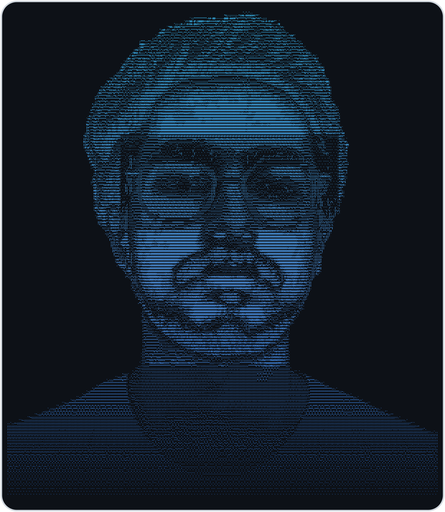
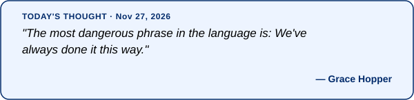

<!-- ═══════════════════════════════════════════════════════ -->
<!-- 1. HERO BANNER & ANIMATED TYPING INTRODUCTION             -->
<!-- ═══════════════════════════════════════════════════════ -->

  <picture>
    <source media="(prefers-color-scheme: dark)" srcset="./assets/hello-dark.svg" />
    
  </picture>

 

  <picture>
    <source media="(prefers-color-scheme: dark)" srcset="./assets/banner-dark.svg" />
    
  </picture>

 

  <a href="https://github.com/yashasvi290906">
    <picture>
      <source
        media="(prefers-color-scheme: dark)"
        srcset="https://readme-typing-svg.demolab.com?font=Fira+Code&weight=600&size=22&duration=3000&pause=1200&color=58A6FF&center=true&vCenter=true&width=680&height=40&lines=Backend+Systems+%7C+Applied+AI+%26+ML;Building+Resilient+APIs+%26+ML+Systems;Python+%E2%80%A2+TypeScript+%E2%80%A2+Java+%E2%80%A2+PyTorch;Engineering+Reliable%2C+Real-World+Code"
      />
      
    </picture>
  </a>

 

<picture>
  <source media="(prefers-color-scheme: dark)" srcset="./assets/divider-dark.svg" />
  
</picture>

<!-- ═══════════════════════════════════════════════════════ -->
<!-- 2. ABOUT ME                                               -->
<!-- ═══════════════════════════════════════════════════════ -->

## About Me

<picture>
  <source media="(prefers-color-scheme: dark)" srcset="./assets/portrait-dark.svg" />
  
</picture>

I'm an AI/ML undergraduate interested in building reliable software and intelligent systems. I enjoy exploring the intersection of backend engineering, full-stack development, and applied machine learning, with a focus on creating solutions that are useful beyond the code itself.

- Interested in **backend systems, API design, and scalable architectures**
- Enjoy building **AI/ML applications** that address practical problems
- Value **clean code**, thoughtful engineering, and continuous learning
- Exploring **open-source development** and learning from the developer community
- **Beyond Code:** I enjoy singing and sharing song covers and edits on [YouTube](https://www.youtube.com/@YashasviSuryaPrakash).

 

<picture>
  <source media="(prefers-color-scheme: dark)" srcset="./assets/divider-dark.svg" />
  
</picture>

<!-- ═══════════════════════════════════════════════════════ -->
<!-- 3. TECH STACK                                             -->
<!-- ═══════════════════════════════════════════════════════ -->

## Tech Stack

#### ✦ Frontend
<picture>
  <source media="(prefers-color-scheme: dark)" srcset="https://skillicons.dev/icons?i=react,nextjs,ts,tailwind&theme=dark&perline=4" />
  
</picture>

  

#### ✦ Backend
<picture>
  <source media="(prefers-color-scheme: dark)" srcset="https://skillicons.dev/icons?i=py,fastapi,nodejs,java&theme=dark&perline=4" />
  
</picture>

  

#### ✦ Applied AI/ML
<picture>
  <source media="(prefers-color-scheme: dark)" srcset="https://skillicons.dev/icons?i=pytorch,tensorflow,sklearn,opencv&theme=dark&perline=4" />
  
</picture>
<picture>
  <source media="(prefers-color-scheme: dark)" srcset="./assets/icon-xgboost-dark.svg" />
  
</picture>

  

#### ✦ Database & Tools
<picture>
  <source media="(prefers-color-scheme: dark)" srcset="https://skillicons.dev/icons?i=postgres,supabase,git,gcp,aws,vscode&theme=dark&perline=6" />
  
</picture>

 

<picture>
  <source media="(prefers-color-scheme: dark)" srcset="./assets/divider-dark.svg" />
  
</picture>

<!-- ═══════════════════════════════════════════════════════ -->
<!-- 4. GITHUB ANALYTICS                                       -->
<!-- ═══════════════════════════════════════════════════════ -->

## GitHub Analytics

  <picture>
    <source
      media="(prefers-color-scheme: dark)"
      srcset="https://github-readme-stats.vercel.app/api?username=yashasvi290906&show_icons=true&hide_border=true&include_all_commits=true&rank_icon=github&bg_color=0D1117&title_color=58A6FF&icon_color=38BDF8&text_color=C9D1D9&border_radius=12"
    />
    
  </picture>
  <picture>
    <source
      media="(prefers-color-scheme: dark)"
      srcset="https://github-readme-stats.vercel.app/api/top-langs/?username=yashasvi290906&layout=compact&hide_border=true&langs_count=8&card_width=380&bg_color=0D1117&title_color=58A6FF&text_color=C9D1D9&border_radius=12"
    />
    
  </picture>

 

  <picture>
    <source
      media="(prefers-color-scheme: dark)"
      srcset="https://streak-stats.demolab.com?user=yashasvi290906&hide_border=true&background=0D1117&ring=58A6FF&fire=38BDF8&currStreakLabel=58A6FF&sideLabels=58A6FF&dates=8B949E&currStreakNum=C9D1D9&sideNums=C9D1D9&stroke=1F6FEB&border_radius=12"
    />
    
  </picture>

 

  <picture>
    <source
      media="(prefers-color-scheme: dark)"
      srcset="https://github-readme-activity-graph.vercel.app/graph?username=yashasvi290906&bg_color=0D1117&color=58A6FF&line=38BDF8&point=58A6FF&area=true&area_color=1F6FEB&hide_border=true&radius=12"
    />
    
  </picture>

<picture>
  <source media="(prefers-color-scheme: dark)" srcset="./assets/divider-dark.svg" />
  
</picture>

<!-- ═══════════════════════════════════════════════════════ -->
<!-- 5. ACHIEVEMENTS & OPEN SOURCE CONTRIBUTIONS               -->
<!-- ═══════════════════════════════════════════════════════ -->

## Achievements and Open Source Contributions

 

| Achievement | Description |
|:---|:---|
| **Quickdraw** | Closed an issue or pull request within 5 minutes of opening |
| **YOLO** | Merged a pull request without waiting for a code review |

### Open Source Contributions (Go, Python & Docs)

- **Meshery (`meshery/meshery`)** — Merged documentation cleanup across architecture and contributing guides ([PR #18349](https://github.com/meshery/meshery/pull/18349)) and submitted a Go CLI fix skipping config initialization for `mesheryctl completion` ([PR #18381](https://github.com/meshery/meshery/pull/18381)).
- **Kubeflow Pipelines (`kubeflow/pipelines`)** — Contributed backend Go and Python fixes for JSON-safe runtime status error serialization ([PR #13176](https://github.com/kubeflow/pipelines/pull/13176)), stale `resourceVersion` watch-stream handling ([PR #13193](https://github.com/kubeflow/pipelines/pull/13193)), and v1 SDK metric compatibility ([PR #13205](https://github.com/kubeflow/pipelines/pull/13205)).

<picture>
  <source media="(prefers-color-scheme: dark)" srcset="./assets/divider-dark.svg" />
  
</picture>

<!-- ═══════════════════════════════════════════════════════ -->
<!-- 6. CONNECT WITH ME                                        -->
<!-- ═══════════════════════════════════════════════════════ -->

## Connect With Me

<picture>
  <source media="(prefers-color-scheme: dark)" srcset="./assets/divider-dark.svg" />
  
</picture>

<!-- ═══════════════════════════════════════════════════════ -->
<!-- 7. TODAY'S THOUGHT                                        -->
<!-- ═══════════════════════════════════════════════════════ -->

## Today's Thought

  <picture>
    <source media="(prefers-color-scheme: dark)" srcset="./assets/thought-dark.svg" />
    
  </picture>

<!-- ═══════════════════════════════════════════════════════ -->
<!-- 8. CLOSING MESSAGE & DIVIDER                              -->
<!-- ═══════════════════════════════════════════════════════ -->

<picture>
  <source media="(prefers-color-scheme: dark)" srcset="./assets/divider-dark.svg" />
  
</picture>

**Thanks for visiting — explore my repositories and feel free to connect or collaborate.**

